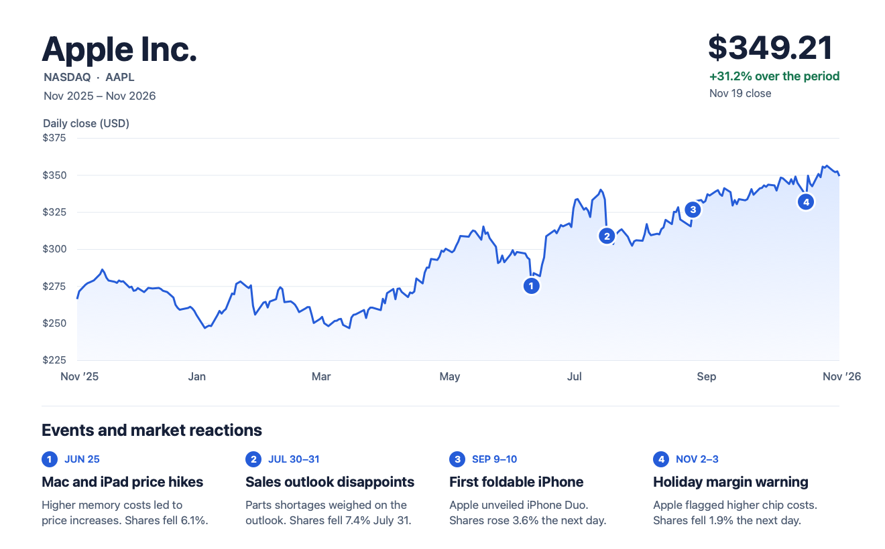

# SEC Filings Dashboard

The prototype imports SEC EDGAR filing metadata and quarterly revenue into Snowflake. It then exports a static JSON snapshot for the dashboard. The initial company list is in [companies.json](companies.json).

## Hackathon demo

Start a static server with `python3 -m http.server 8000 --directory site`. Open [the trading replay](http://localhost:8000/replay.html) for the simulated Apple market. The [filings dashboard](http://localhost:8000/) reads a locally generated Snowflake snapshot.

## Build the filings snapshot

1. Run `python3 -m venv .venv` and `.venv/bin/pip install -r requirements.txt`.
2. Set `SNOWFLAKE_CONNECTION_NAME` to a Snowflake Python Connector profile with access to a warehouse and permission to create and write tables in the target database and schema. For local key-pair authentication, you can instead put your `account`, `user`, `role`, `warehouse`, `database`, and `schema` in `.local/snowflake-connection.json` and store the registered key at `.local/snowflake-key.p8`.
3. Set `SEC_USER_AGENT` to a project name and contact email, then run `.venv/bin/python ingest.py`.

The loader creates and merges into `COMPANIES`, `FILINGS`, and `QUARTERLY_REVENUE`. It exports the dashboard from those tables to `site/dashboard.json`. The snapshot covers the last 730 days. If a standalone fourth-quarter revenue figure is unavailable, the loader labels the figure derived from full-year revenue minus the first three contiguous quarters.

Private keys, the local setup directory, and generated snapshots are excluded from Git. GitHub Pages deployment, daily refresh, and broader Fortune 500 coverage are later phases.

## Apple trading replay

Open /replay.html on the same local HTTP server. The replay uses fictional weekday closes and fictional headlines from January 2000 through the latest simulated weekday in New York. It starts with $10,000 in virtual cash and pauses for trading decisions and a performance summary at each year-end. Cashing out values and closes the position at that checkpoint; continuing carries the portfolio forward. Later years use deterministic simulated prices and recurring fictional market events. Orders are evaluated at the next simulated close. The simplified short model reserves the sale proceeds and an equal amount of collateral at the current mark. The replay omits fees, borrowing charges, dividends, and forced liquidation. The buy-and-hold benchmark marks a fractional, all-cash starting investment at the close immediately after the first decision.
